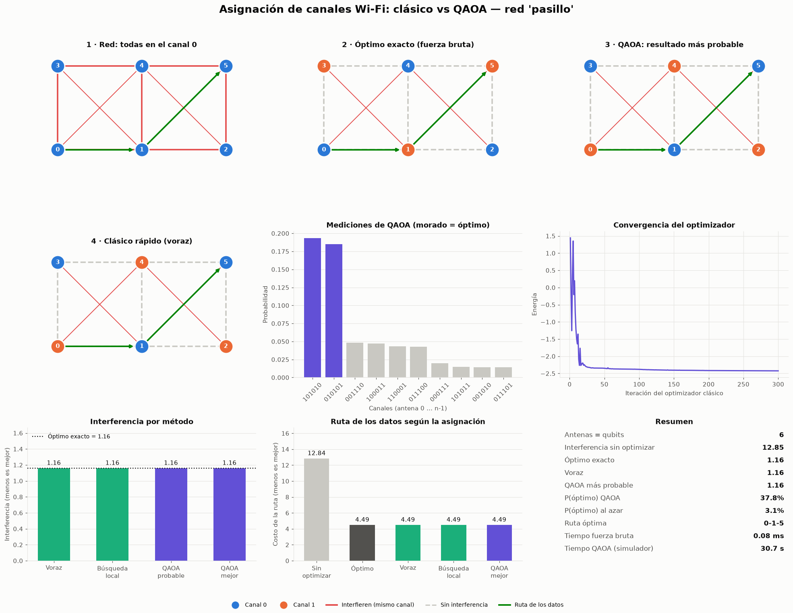
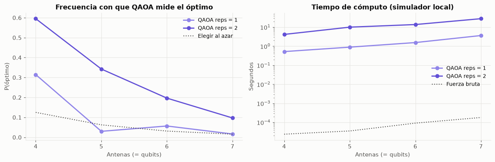

# Asignación de canales Wi-Fi con QAOA: clásico vs cuántico-híbrido

**IBM Quantum Hackathon 2026 · Reto 5.2 · Algoritmos y aplicaciones**

Las antenas Wi-Fi cercanas que transmiten en el mismo canal se interfieren. Este proyecto reparte **dos canales** entre las antenas para que la interferencia sea mínima, compara un algoritmo cuántico-híbrido (**QAOA**, ejecutado con Qiskit) con métodos clásicos y mide cómo cambia la ruta de los datos con cada asignación.



## Idea en una línea

Cada antena es un **qubit** (canal 0 o canal 1). La interferencia total es la energía de un **modelo de Ising antiferromagnético**, que equivale a **MaxCut ponderado**:

$$E(s)=\sum_{(i,j)}\frac{w_{ij}}{2}\,(1+s_is_j) \quad\Longrightarrow\quad \text{interferencia} = W - \text{corte}$$

Si se minimiza la energía, se minimiza la interferencia. QAOA busca ese estado de mínima energía.

## Contenido del repositorio

**Código principal: [`main.py`](main.py)**, la demo que recorre el proyecto completo de principio a fin.

```
qaoa-canales-wifi/
├── main.py                  ← código principal (demo)
├── proyecto.ipynb           teoría, desarrollo, resultados y referencias
├── canales/
│   ├── config.py            parámetros de todo el proyecto
│   ├── modelo/              Parte 1 · red de antenas y hamiltoniano
│   │   ├── red.py
│   │   ├── redes.py
│   │   └── hamiltoniano.py
│   ├── cuantico/            Parte 2 · QAOA
│   │   └── qaoa.py
│   ├── clasico/             Parte 3 · métodos clásicos y rutas
│   │   ├── metodos.py
│   │   └── rutas.py
│   └── comparacion/         Parte 4 · métricas, escalamiento y gráficas
│       ├── metricas.py
│       ├── escalamiento.py
│       └── graficas.py
├── figuras/                 imágenes del README
├── requirements.txt
└── LICENSE
```

## Instalación

Se necesita Python 3.10 o superior.

```bash
git clone https://github.com/yostinquispeg-alt/qaoa-canales-wifi.git
cd qaoa-canales-wifi
python -m venv .venv
# Windows:   .venv\Scripts\activate
# Linux/Mac: source .venv/bin/activate
pip install -r requirements.txt
```

## Uso

**Notebook (recomendado):**

```bash
jupyter notebook proyecto.ipynb
```

Si solo quieres ver los resultados, GitHub muestra el notebook ya ejecutado con todas sus figuras.

**Demo (código principal):**

```bash
python main.py                        # red "triangulos" (5 antenas, ~5 s)
python main.py pasillo                # red "pasillo" (6 antenas, ~30 s)
python main.py todas --escalamiento   # ambas redes y el barrido de 4 a 7 antenas
python main.py todas --guardar figuras   # guarda las figuras en vez de abrir ventanas
```

La demo avanza en seis pasos: el problema, el modelo cuántico, QAOA, los métodos clásicos y las rutas, la comparación (tabla y display completo) y una conclusión con números. Los parámetros están en [`canales/config.py`](canales/config.py).

## Métodos comparados

| Método | Tipo | Qué hace |
|---|---|---|
| Fuerza bruta | Clásico exacto | Enumera las $2^N$ asignaciones; es la referencia |
| Voraz | Heurística clásica | Las antenas más interferidas eligen primero el canal con menos conflicto |
| Búsqueda local | Heurística clásica | Cambia una antena mientras mejore, con 20 reinicios aleatorios |
| QAOA | Cuántico-híbrido | Circuito de `p` capas; COBYLA ajusta los ángulos; se mide 4000 veces |

**Rutas.** El costo de cada enlace es *costo base + α · interferencia en sus extremos*, y la ruta se calcula con Dijkstra (`rustworkx`). Así se ve cómo la asignación de canales afecta la comunicación.

## Resultados principales

| Red | Antenas | Óptimo | QAOA (más probable) | P(óptimo) QAOA | P(óptimo) al azar |
|---|---|---|---|---|---|
| pasillo | 6 | 1.16 | 1.16 ✔ | 37.8 % | 3.1 % |
| triangulos | 5 | 1.00 | 3.50 ✘ | 11.2 % | 6.2 % |

- En las dos redes, la **mejor** medición de QAOA alcanza el óptimo exacto. Su resultado **más probable** acierta en la red pasillo, pero no en la red con más frustración.
- QAOA mide el óptimo con bastante más frecuencia que si se eligiera al azar.
- En el escalamiento (4 a 7 antenas), P(óptimo) baja al crecer la red y mejora al pasar de 1 a 2 capas:



- En simulador, QAOA tarda segundos y la fuerza bruta, fracciones de milisegundo. **No se afirma ventaja cuántica**: lo que aporta el proyecto es una formulación limpia de un problema real y una comparación medible y reproducible.

## Limitaciones

- Solo dos canales y sin interferencia entre canales distintos. Con $k$ canales el problema pasa a ser coloreo de grafos y necesita $N\cdot k$ qubits.
- El peso de la interferencia y el costo de las rutas usan reglas propuestas por el equipo, no un modelo de propagación físico.
- Todo se ejecuta en simulador local (statevector). La misma formulación puede llevarse a hardware de IBM con `qiskit-ibm-runtime`.

## Referencias

1. IBM Quantum. *Quantum approximate optimization algorithm* (tutorial). https://quantum.cloud.ibm.com/docs/en/tutorials/quantum-approximate-optimization-algorithm
2. Qiskit. *qiskit-addon-opt-mapper*. https://github.com/Qiskit/qiskit-addon-opt-mapper
3. E. Farhi, J. Goldstone, S. Gutmann. *A Quantum Approximate Optimization Algorithm*. arXiv:1411.4028 (2014).
4. A. Lucas. *Ising formulations of many NP problems*. Front. Phys. 2:5 (2014). arXiv:1302.5843
5. M. X. Goemans, D. P. Williamson. *Improved approximation algorithms for maximum cut and satisfiability problems using semidefinite programming*. J. ACM (1995).
6. A. Abbas et al. *Challenges and Opportunities in Quantum Optimization*. Nat. Rev. Phys. (2024). arXiv:2312.02279

La lista completa está al final de [`proyecto.ipynb`](proyecto.ipynb).

## Licencia

[MIT](LICENSE)
